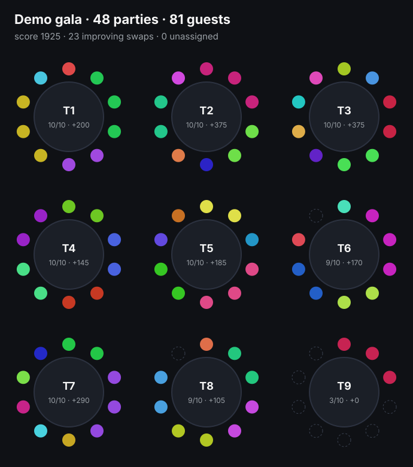

# seating-optimizer

**Who sits with whom at a networking dinner, with people who came together never split up.**

<p align="center"></p>

Built for a business gala with hundreds of paid seats, where guests fill in a short profile (industry, interests, revenue band) and can name people they want to meet or avoid. The organiser presses one button and gets a plan.

It is small enough to read in one sitting: around 200 lines of TypeScript, zero dependencies.

## The rules

**Hard constraints (never broken)**
- A **party** is everyone booked together (a buyer and their companions). A party always sits at one table.
- **Blocks** are bidirectional and work by person *or* by company: "not with Company X" keeps everyone from Company X away.
- Table capacity. A party bigger than any table is reported as `oversized`, never forced in.

**Soft affinity (scored)**

| signal | points |
|---|---|
| both parties asked for each other | +50 |
| one asked for the other (by person or company) | +20 |
| at least one shared interest | +15 |
| same revenue band, **only if both opted in** | +20 |
| a table that mixes industries | +10 per table |

## The algorithm

1. **Greedy pairing.** Score every compatible pair of parties, sort descending, and seat the best pairs together; a party already seated pulls its best match to its table if it fits.
2. **Round-robin for the rest.** Each remaining party goes to the table with the *fewest people from its own industry*, then the most free seats, so tables mix by default.
3. **2-opt local search.** Swap whole parties of equal size between tables whenever it raises the total score without creating a conflict, until a pass finds nothing (max 3 passes).

No solver: at this scale (tens to hundreds of parties) greedy + 2-opt finishes in milliseconds. The demo above (48 parties, 81 seats, 9 tables) plans in about 40 ms with 23 improving swaps. The function is pure and re-runnable from scratch on current data.

## Usage

```ts
import { planSeating } from "seating-optimizer";

const plan = planSeating({
  tables: [{ number: 1, capacity: 10 }, { number: 2, capacity: 10 }],
  parties: [
    { id: "cart_81", guests: [
      { id: "ana", company: "Bloom", industry: "Hospitality", interests: ["export"], wants: { companies: ["Nordic Logistics"] } },
      { id: "ana+1" },                                   // companion, no profile, still needs a seat
    ] },
    { id: "cart_82", guests: [{ id: "radu", company: "Nordic Logistics", industry: "Logistics", blocks: { guestIds: ["mihai"] } }] },
  ],
});
// plan.tables[i].parties[j] -> { id, guestIds, seats, score }, plan.unassigned, plan.score, plan.swaps
```

```bash
npm test          # 7 tests, node:test
npm run demo      # regenerates docs/demo-plan.svg from a seeded fictional event
```

The tests check that parties are never split and capacity is never exceeded, that blocks hold by person and by company even against a mutual wish, that mutual wishes beat one-way ones, that the revenue rule needs both opt-ins, that oversized parties are reported, and that 2-opt fixes a bad greedy start.

`renderSeatingSvg(plan)` draws the plan you see above: one colour per party (golden-angle hues, so colours never repeat), seat dots around each table, and the table's affinity score.

## License

MIT
